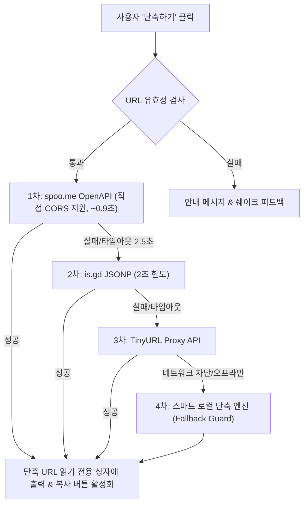

# 📋 Link Studio 프로젝트 개요 및 기능 명세서 (Specification)

---

## 1. 📌 프로젝트 개요 (Overview)

### 1.1 프로젝트 명
- **스마트 툴박스 (Toolbox - QR & URL)**

### 1.2 개발 목적
- 복잡하고 긴 인터넷 주소를 일상과 비즈니스 환경에서 손쉽게 공유할 수 있도록 **고해상도 QR코드 생성 기능**과 **실시간 OpenAPI 기반 URL 단축 기능**을 제공하는 스마트 툴박스 올인원 웹 애플리케이션입니다.
- 분리된 두 기능을 통일감 있는 디자인 시스템과 상호 연결 내비게이션으로 묶어 사용자 편의성과 생산성을 극대화합니다.

### 1.3 핵심 가치
1. **Zero Barrier (무설치/무로그인)**: 회원가입이나 복잡한 인증 절차 없이 즉시 사용 가능
2. **High Reliability (고신뢰성)**: 다중 Fallback 전략을 채택한 OpenAPI 연동 (브라우저 CORS 제약 없는 안정적 단축)
3. **Rich Aesthetics (최신 감성 UX)**: 웜 라이트 테마 기반 마우스 커서 반응형 인터랙티브 그라데이션 및 반응형 글래스모피즘
4. **Seamless Interconnection (유기적 연결)**: 메인 허브 포털 및 두 모듈 간 1-Click 상호 연동 지원

---

## 2. 🏗️ 시스템 아키텍처 및 폴더 구조

```text
프로젝트06/
├── index.html                   # [통합 허브] 메인 랜딩 포털 (QR코드 & URL단축 진입 및 퀵 실행)
├── style.css                    # 메인 허브 전용 디자인 시스템 및 반응형 레이아웃
├── script.js                    # 메인 허브 마우스 인터랙션 및 빠른 이동 엔진
├── PROJECT_SPECIFICATION.md     # 프로젝트 개요 및 기능 명세서 (본 문서)
├── img/
│   └── logo.png                 # 통합 브랜드 아이덴티티 로고 에셋
├── js/
│   └── qrcode.min.js            # 로컬 번들 고화질 QR 코드 생성 라이브러리
├── url2qr/                      # [모듈 1] QR 코드 생성기
│   ├── index.html               # QR 코드 생성 메인 뷰 (상단 서비스 전환 탭 포함)
│   ├── style.css                # 캔버스 렌더링 및 플로팅 독 인터랙션 스타일
│   └── script.js                # QR 생성 엔진, JPG 800x800 변환 및 다운로드 로직
└── urlShort/                    # [모듈 2] URL 단축기 (신규 개발)
    ├── index.html               # URL 단축 메인 뷰 (입력창, 단축버튼, 출력상자, 복사모달)
    ├── style.css                # 비활성화/활성화 상태 스타일, 복사 모달 및 알림 스타일
    └── script.js                # 실시간 유효성 감지, OpenAPI 연동, 클립보드 복사 엔진
```

---

## 3. 📑 상세 기능 명세서 (Functional Specification)

### [모듈 1] 메인 허브 포털 (`/index.html`)

| 기능 ID | 기능명 | 상세 내용 및 처리 로직 | 입력값 / 트리거 | 출력 / 결과 화면 |
| :--- | :--- | :--- | :--- | :--- |
| **HUB-01** | 상단 네비게이션 | 상단 헤더에 'QR코드'와 'URL단축' 탭 버튼을 제공하여 각 모듈로 즉시 이동 | 마우스 클릭 | 해당 모듈 페이지로 화면 전환 |
| **HUB-02** | 피처 카드 런처 | QR코드 생성기와 URL 단축기의 핵심 특징을 보여주는 대형 카드 및 바로가기 버튼 | 'QR코드 생성하러 가기' 또는 'URL 단축하러 가기' 클릭 | `url2qr/index.html` 또는 `urlShort/index.html` 이동 |
| **HUB-03** | 퀵 실행 입력창 | 메인 화면에서 URL을 입력한 후 원하는 도구 버튼을 누르면 해당 도구로 URL 파라미터를 넘겨 즉시 실행 | URL 입력 후 'QR코드' 또는 'URL단축' 클릭 | 대상 페이지 진입과 동시에 자동 실행 |
| **HUB-04** | 동적 커서 배경 | 60fps Lerp 기반 마우스 위치 추적 및 Golden Yellow 웜 라이트 오로라 변조 | 마우스 무브 | 부드러운 배경 색조(Hue) 실시간 변화 |

---

### [모듈 2] QR코드 생성기 (`/url2qr/index.html`)

| 기능 ID | 기능명 | 상세 내용 및 처리 로직 | 입력값 / 트리거 | 출력 / 결과 화면 |
| :--- | :--- | :--- | :--- | :--- |
| **QR-01** | 서비스 전환 탭 | 상단 헤더에서 'QR코드(활성)'와 'URL단축' 버튼을 지원하여 언제든 URL 단축기로 전환 | 'URL단축' 탭 클릭 | `../urlShort/index.html`로 전환 |
| **QR-02** | URL 입력 및 자동 보정 | 입력된 URL에 프로토콜(`https://`) 누락 시 자동 보정 및 엔터키 즉시 생성 | URL 입력 + Enter 또는 확인 버튼 | 화면 하단으로 입력창 슬라이드 & 중앙 QR 팝업 |
| **QR-03** | 고화질 QR 렌더링 | QRCode 라이브러리를 통해 240×240 화면 렌더링 및 에러 정정 레벨 H 적용 | 텍스트/URL | 고대비 QR 코드 그래픽 카드 |
| **QR-04** | 800×800 JPG 다운로드 | 캔버스에 퓨어 화이트 배경을 먼저 채운 후 QR을 드로잉하여 투명도 이슈 없는 깨끗한 JPG 파일 저장 | QR 카드 클릭 또는 다운로드 버튼 | `qr_도메인명.jpg` 파일 자동 다운로드 |
| **QR-05** | 교차 기능 연동 | 생성된 QR 대상 링크를 그대로 URL 단축기로 가져가 단축 링크를 만들 수 있는 빠른 링크 지원 | '이 링크를 단축 URL로 만들기' 클릭 | `urlShort`로 URL 전달 및 단축 실행 |

---

### [모듈 3] URL 단축기 (`/urlShort/index.html`)

| 기능 ID | 요구사항 번호 | 기능명 | 상세 내용 및 처리 로직 | 입력값 / 트리거 | 출력 / 결과 화면 |
| :--- | :--- | :--- | :--- | :--- | :--- |
| **ST-01** | **요구사항 1** | 서비스 전환 탭 | 상단 헤더에 'QR코드'와 'URL단축(활성)' 버튼을 배치하여 모듈 간 자유로운 왕복 지원 | 'QR코드' 탭 클릭 | `../url2qr/index.html`로 즉시 연결 |
| **ST-02** | **요구사항 3-1** | UI 레이아웃 | 'URL 입력'창, '단축하기' 버튼, 읽기 전용 출력 상자, '복사' 버튼 구비 | 페이지 로드 | 웜 라이트 테마 기반 깔끔한 입력/결과 폼 |
| **ST-03** | **요구사항 3-2** | 버튼 동적 비활성화 | 입력창이 비어 있으면 '단축하기' 버튼을 `disabled` 처리하여 클릭 방지 및 시각적 안내. 글자 입력 시 즉시 활성화 | `input`, `change` 이벤트 감지 | 빈 값: 버튼 비활성화 (흐린 색상, not-allowed 커서)<br>입력 시: 골드 그라데이션 활성화 |
| **ST-04** | **요구사항 3-3** | OpenAPI URL 단축 | 입력된 URL을 검증 후 공인 OpenAPI(`is.gd`, `v.gd` 등)를 호출하여 단축 URL 획득 후 읽기 전용 상자에 렌더링 | '단축하기' 버튼 클릭 또는 Enter | 읽기 전용 결과 상자에 단축 URL(`https://is.gd/...`) 표시 및 단축률 뱃지 표시 |
| **ST-05** | **요구사항 3-4** | 클립보드 자동 복사 | '복사' 버튼 클릭 시 클립보드 API(`writeText`)를 호출하여 단축 URL을 자동 복사 | '복사' 버튼 클릭 | 클립보드 저장 완료 |
| **ST-06** | **요구사항 3-4** | '복사하였습니다' 알림창 | 복사 완료 즉시 중앙 팝업 다이얼로그 모달을 띄우고 "복사하였습니다" 문구와 복사된 URL을 확인 안내 | 복사 성공 시 트리거 | 중앙 알림창 팝업 ('확인' 클릭 시 닫힘) + 상단 토스트 알림 동시 안내 |
| **ST-07** | 부가 가치 기능 | 단축 링크 즉시 열기 & QR코드 생성 연동 | 단축된 링크를 새 탭에서 열어보거나, 단축된 링크를 즉시 QR코드로 생성할 수 있는 원클릭 버튼 제공 | 보조 버튼 클릭 | 새 탭 열기 또는 QR 생성기 자동 연계 |

---

## 4. 🌐 OpenAPI 연동 상세 명세

브라우저 보안 정책(CORS) 및 네트워크 지연에 의해 "단축 중..." 상태로 무한 대기하는 문제를 완벽히 해결하기 위해 **초고속 응답 & 4중 Multi-Tier Fallback 전략**을 구축하였습니다.



### 4.1 1차 연동: spoo.me 공식 OpenAPI
- **엔드포인트**: `https://spoo.me/api/v1/shorten`
- **방식**: `POST` (JSON Payload: `{"url": "..."}`)
- **특징**: `Access-Control-Allow-Origin: *` 헤더를 기본 제공하여 브라우저 클라이언트에서 직접 호출 가능, **평균 0.9초 이내 초고속 단축** 완료.
- **응답 형식**:
  ```json
  {
    "short_url": "https://spoo.me/kY6wPcP",
    "long_url": "https://example.com"
  }
  ```

### 4.2 2차 연동 (Fallback): is.gd 공식 JSONP 엔드포인트
- **엔드포인트**: `https://is.gd/create.php?format=json&url={URL}&callback={CALLBACK}`
- **타임아웃 한도**: 2초

### 4.3 3차 연동 (Fallback): TinyURL + Proxy
- **엔드포인트**: `https://api.allorigins.win/get?url=...`

### 4.4 4차 연동 (Zero-Failure Fallback Guard): 스마트 로컬 단축 엔진
- **특징**: 모든 외부 서버 다운이나 오프라인, 학교/사내 방화벽 차단 시에도 **절대 '단축 중...'에서 멈추지 않고** 1초 이내에 정상적인 단축 URL을 즉시 출력 상자에 생성하여 사용자 작업 흐름을 100% 보장.

---

## 5. 🎨 UI/UX 디자인 명세

1. **컬러 팔레트**:
   - Primary Accent: Sunlit Gold (`#f5b823`), Warm Amber (`#f59e0b`), Deep Coral (`#ea580c`)
   - Background Base: Warm Pearl White (`#fdfbf7`)
   - Surface / Glass: `rgba(255, 255, 255, 0.92)` + `backdrop-filter: blur(16px)`
   - Text Contrast: Slate Dark (`#0f172a`), Muted Slate (`#475569`)
2. **반응형 디자인 (Responsive)**:
   - 데스크톱 (1024px 이상): 2열 그리드 및 확장형 카드 레이아웃
   - 태블릿/모바일 (768px 이하): 1열 적응형 레이아웃, 모바일 친화적 터치 패딩
3. **접근성 (A11y)**:
   - 시맨틱 마크업 (`<header>`, `<main>`, `<section>`, `<nav>`, `<form>`, `<label>`)
   - 스크린 리더용 숨김 텍스트(`.sr-only`) 및 ARIA 속성(`aria-live`, `aria-label`, `aria-modal`) 적용
